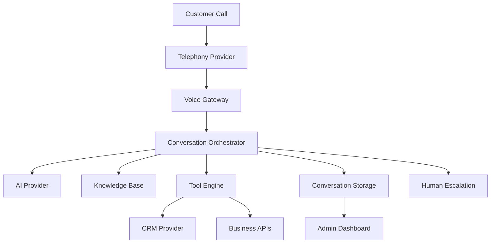

# Architecture

This project follows a modular monolith approach. The backend is separated by business capability, while the frontend provides a SaaS-style administration dashboard and call simulator.

## Principles

- Multi-tenancy by tenant ID on every relevant entity
- Provider abstraction for AI, CRM, and telephony
- Clear module boundaries with minimal circular dependencies
- Audit logging and secure-by-default configuration
- Mock implementations for local demo and no-credential startup
